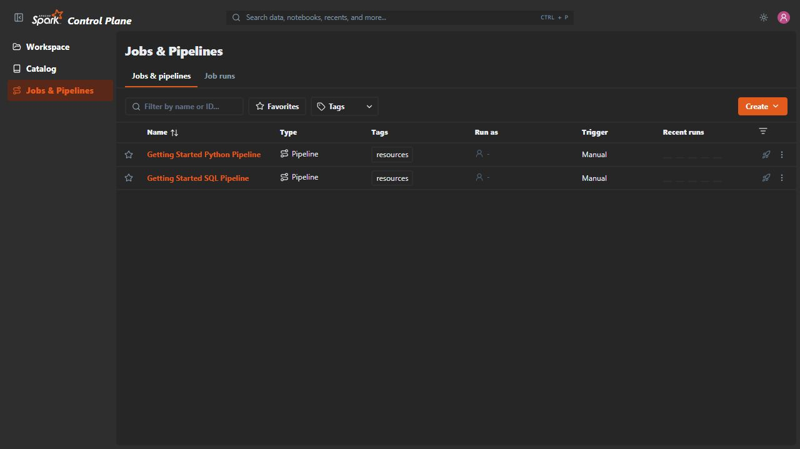
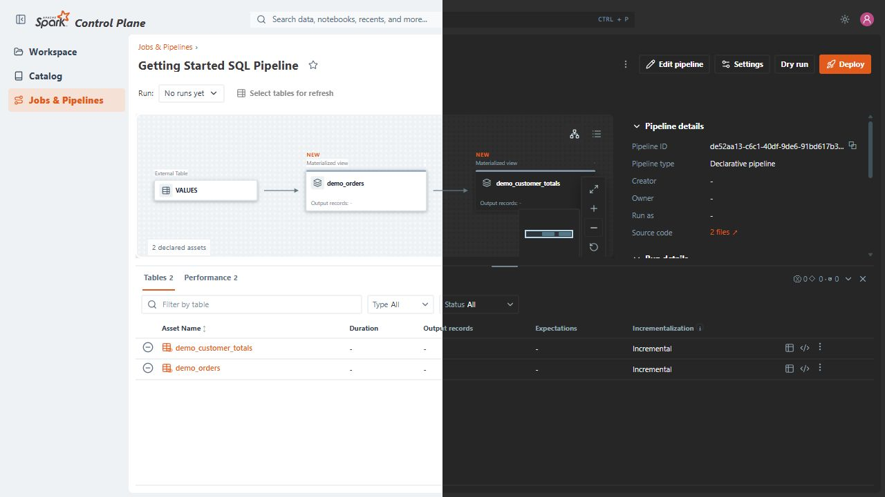

# Spark Control Plane

[](https://opensource.org/license/apache-2-0)
[](package.json)
[](tests/README.md)
[](src/)
[](package.json)

Spark Control Plane is a web UI for managing Apache Spark Declarative Pipelines
(SDP). Discover pipeline projects, explore datasets and lineage, deploy pipeline
versions, schedule runs, and monitor execution through Spark Connect.

[Capabilities](#capabilities) ·
[Compatibility](#build--compatibility-status) ·
[Feature roadmap](#feature-roadmap) ·
[Screenshots](#screenshots) ·
[Quick start](#quick-start) ·
[Documentation](#documentation) ·
[Development](#development) ·
[License](#license)

## Capabilities

- Discover and inspect pipeline definitions from mounted project files.
- Visualize declared datasets, Python outputs, flows, and lineage.
- Deploy source versions and submit runs through the Spark Pipelines CLI.
- Schedule runs and route webhook and file-arrival events.
- Browse Polaris or Spark catalog metadata and preview bounded samples through
  Spark Connect.
- Persist pipeline identity, deployments, run state, and history in PostgreSQL.

The [source architecture guide](src/README.md) is the canonical overview of
system boundaries and data flow. The [server guide](src/server/README.md)
contains the detailed server architecture and behavior contracts.

## Build & Compatibility Status

For now, the following table outlines compatibility based on manual testing.

| Branch   | Status                                                                                                                    |
|----------|---------------------------------------------------------------------------------------------------------------------------|
| `main`   | [](#build--compatibility-status) |
|          | [](#build--compatibility-status) |
|          | [](#build--compatibility-status)       |

## Feature Roadmap

This roadmap outlines planned features for a future `1.0` release.

### Execution and Run Tracking

- [ ] **Serverless pipeline execution.** Use Spark master as the cluster entry
  point and remove the need for user-configured Spark Connect. Spark Control
  Plane would ask the master to create a Python-compatible driver for each
  pipeline; each driver would manage its executors.
- [ ] **Per-pipeline run tracking.** Have each driver report stages for its
  pipeline, enabling independent run tracking and clearer time spent queued,
  provisioning, and executing.

### Deployment and Editing

- [ ] **Version-controlled deployments.** Support pipelines deployed through a
  version control system.
- [ ] **Workspace editor and commits.** Add live code editing and commits in the
  workspace.
- [ ] **Pipeline definition editor.** Add live editing for pipeline definitions.

### Search and Navigation

- [ ] **App-wide search.** Make the global search bar search across the application,
  including data, notebooks, recent items, and other supported content.

### Alerts and Compatibility

- [ ] **Pipeline failure alerts.** Support custom webhooks and email; Slack and
  Microsoft Teams integrations are under consideration.
- [ ] **Automated compatibility and feature testing.** Test supported Spark
  versions and catalog implementations for compatibility and feature coverage.

### Triggers and Catalogs

- [ ] **Additional trigger types.** Add filesystem and AWS triggers.
- [ ] **Additional catalogs.** Add Unity Catalog; Gravitino and Hive are under
  consideration.

## Screenshots

These screenshots come from the repository's local demo stack.





## Quick start

The local demo requires Node.js 24.19.0, Docker Engine, and Docker Compose
v2.20 or later.

```powershell
npm ci
npm run demo:up
```

Open the browser address printed by the command. Stop the demo with:

```powershell
npm run demo:down
```

For host-based Vite development with external services, configure the process
environment using the [deployment guide](docs/deployment.md) and [operations
runbook](docs/operations.md), then run `npm run dev`.

## Documentation

This README is the project entry point. Each topic's detailed guide is its
source of truth; update that guide when its facts or contracts change.

| Topic                                       | Source of truth                                                                            |
|---------------------------------------------|--------------------------------------------------------------------------------------------|
| System boundaries and source areas          | [Source architecture](src/README.md)                                                       |
| Deployment and environment configuration    | [Deployment guide](docs/deployment.md)                                                     |
| Startup, runtime behavior, and recovery     | [Operations runbook](docs/operations.md)                                                   |
| PostgreSQL schema, migrations, and recovery | [PostgreSQL persistence](docs/postgres-persistence.md)                                     |
| HTTP route behavior                         | [API characterization](docs/api-characterization.md)                                       |
| Machine-readable HTTP schema                | [OpenAPI document](docs/openapi.json)                                                      |
| Pipeline discovery and execution            | [Pipeline module](src/server/pipeline/README.md)                                           |
| Web application                             | [Web application](src/web/README.md)                                                       |
| UI icons                                    | [Icon inventory](docs/icon-inventory.md)                                                   |
| Example projects                            | [Example pipelines](examples/README.md)                                                    |
| Container files and local demo              | [Container configuration](docker/README.md)                                                |
| Test suites                                 | [Test guide](tests/README.md) and [managed integration tests](tests/integration/README.md) |

Other server and shared-module guides are located beside their source under
`src/`.

## Development

Install dependencies, configure the external services, then start the Vite
development server:

```powershell
npm ci
npm run dev
```

Run the core local checks with:

```powershell
npm run lint
npm run build
npm run test:unit
```

The [test guide](tests/README.md) lists the remaining local and managed
integration suites.

## Security

- Mount only trusted pipeline projects. Python definitions are imported during
  graph discovery and can execute code.
- Keep control-plane, Spark, and database endpoints on trusted networks. The
  deployment guide describes the API exposure boundary.
- Do not commit credentials, runtime state, or private pipeline data.

## Contributing

Keep changes focused and include validation evidence. Keep each behavior or
contract in its owning guide. Follow the nearest `AGENTS.md` or `README.md` for repository
instructions.

## License

Unless a file or asset has a separate notice, project-authored source code and
documentation are licensed under the Apache License 2.0. See [LICENSE](LICENSE)
and [NOTICE](NOTICE) for the terms, third-party attributions and affiliations.
