# Spark Control Plane server

The server is the backend for pipeline discovery, deployment, run scheduling,
trigger delivery, catalog browsing, and run history. The production process is
a standalone Node HTTP server. It serves the built React application and the
versioned API, while PostgreSQL stores control-plane state and Spark Connect
executes pipeline work and bounded data previews.

## Architecture

This flowchart is the maintained architecture source: it is Mermaid text in
this README, so topology and styling changes can be reviewed with normal code
changes. Mermaid `classDef` styles give each subsystem a consistent color.

```mermaid
---
config:
  theme: base
  themeVariables:
    darkMode: true
    background: "#000000"
    edgeLabelBackground: "#00000066"
---
flowchart LR
    Browser["Browser and API clients"]
    AIStor["AIStor webhook sender"]

    subgraph SCP["Spark Control Plane"]
        HTTP["Standalone Node server<br/>composition and lifecycle"]
        UI["Built React assets<br/>dist/"]
        API["Shared HTTP adapter<br/>/api/v1"]
        Registry["Pipeline registry service<br/>saved snapshots, deploy, runs"]
        Triggers["Trigger services<br/>events, schedules, delivery"]
        Worker["Run coordinator<br/>queue, leases, recovery"]
        CLI["Local supervisor<br/>spark-pipelines CLI"]
        Catalog["Catalog service"]
    end

    Pipelines["Pipelines source folder<br/>yaml definitions and source files"]
    PostgreSQL[("PostgreSQL<br/>control-plane state")]
    Polaris[("Polaris<br/>metadata database")]
    Spark["Spark Connect"]
    Browser --> HTTP
    AIStor -->|" Bearer-authenticated event "| HTTP
    HTTP -->|" serves "| UI
    HTTP -->|" dispatches API requests "| API
    API --> Registry
    API --> Catalog
    Registry --> Triggers
    Registry -->|" explicit full-folder refresh "| Pipelines
    Registry -->|" snapshots, identity, deployment, run and audit state "| PostgreSQL
    Triggers -->|" definitions, events, delivery outcomes "| PostgreSQL
    Triggers -->|" submit through registry service "| Worker
    Worker -->|" claim, lease, recover "| PostgreSQL
    Worker -->|" start or inspect by run ID "| CLI
    CLI -->|" official pipeline execution "| Spark
    Catalog -->|" hierarchy and enrichment in Polaris mode "| Polaris
    Catalog -->|" hierarchy, details, and samples in Spark mode "| Spark
    class Browser,AIStor client
    class HTTP,UI transport
    class Worker,CLI execution
    classDef client fill: #263341, stroke: #94a3b8, stroke-width: 2px
    classDef transport fill: #1e3a5f, stroke: #60a5fa, stroke-width: 2px
    classDef execution fill: #1e3a5f, stroke: #60a5fa, stroke-width: 2px
    style SCP fill: #5a281866, stroke: #00000000, color: #e25a1c
    style API fill: #f68d23, stroke: #fff176, stroke-width: 2px
    style Registry fill: #09655e, stroke: #b2dfdb, stroke-width: 2px
    style Pipelines fill: #263341, stroke: #94a3b8, stroke-width: 2px
    style Triggers fill: #9575cd, stroke: #c7badd, stroke-width: 2px
    style PostgreSQL fill: #27455d, stroke: #31648c, stroke-width: 2px
    style Polaris fill: #03242d, stroke: #02757d, stroke-width: 2px
    style Catalog fill: #1e3a5f, stroke: #60a5fa, stroke-width: 2px
    style Spark fill: #5a2818, stroke: #e25a1c, stroke-width: 2px
```



### Runtime layers

- `runtime/standaloneServer.ts` is the production composition root. It creates
  the HTTP server, registry and catalog services, handlers, and process
  lifecycle. `runtime/requestHandler.ts` dispatches documentation, health,
  metrics, Spark History proxy, API, and static-file requests.
- `api/` is the shared HTTP adapter used by production and the Vite development
  adapter. Route modules validate and translate HTTP requests; business rules
  live in services. The adapter adds a correlation ID and returns sanitized
  errors.
- `pipeline/pipelineRegistryService.ts` composes discovery, PostgreSQL
  persistence, the run coordinator, and trigger services. It owns pipeline
  registry operations, not the HTTP protocol.
- `persistence/` implements the control-plane PostgreSQL contract. `catalog/`
  selects Polaris metadata or Spark Connect as the hierarchy source; Spark
  Connect supplies details and bounded samples in either mode.
- `triggers/` owns event ingestion, scheduling, shared delivery, and
  dead-letter recovery. See [`triggers/README.md`](./triggers/README.md).
- `observability/` exposes process-local Prometheus text metrics at `/metrics`.
  See [`observability/README.md`](./observability/README.md).
- `types/` contains service and persistence contracts; `history/` builds
  resumable exports from persisted run and audit events.

The standalone server owns the lifecycle of services it creates. If a caller
injects an already initialized service, that caller retains its lifecycle and
must shut it down. The Vite plugin is a development host; the standalone Node
server is the production host.

## HTTP surface

The production contract is `/api/v1`. The checked-in
[`docs/openapi.json`](../../docs/openapi.json) is served at `/openapi.json`, and
`/docs` serves Swagger UI for it.

| Path                         | Purpose                                                                                                                                                          |
|------------------------------|------------------------------------------------------------------------------------------------------------------------------------------------------------------|
| `GET /health`                | Process liveness. Returns `503` while shutdown is underway.                                                                                                      |
| `GET /ready`                 | Cached readiness for initialization, discovery, persistence, worker admission, operational snapshot, and stuck runs.                                             |
| `GET /metrics`               | Process-local Prometheus text metrics. Counters and gauges reset when the process restarts.                                                                      |
| `/api/v1/pipelines...`       | List and inspect pipelines; deploy a source version; list or submit runs; read source files and bounded node samples.                                            |
| `/api/v1/runs...`            | Read run detail/status and paginated events; request cancellation.                                                                                               |
| `/api/v1/triggers...`        | Manage triggers, ingest events, inspect schedules and delivery decisions, and replay or discard dead letters. AIStor events require the configured bearer token. |
| `/api/v1/catalogs...`        | Browse configured Polaris or Spark catalogs, schemas, tables, metadata, and bounded samples.                                                                     |
| `GET /api/v1/history/export` | Export run and audit history in resumable pages.                                                                                                                 |
| Other paths                  | Serve built UI assets and browser routes from `dist/`.                                                                                                           |

Run submission is asynchronous: `POST /api/v1/pipelines/{pipelineId}/runs`
persists a `QUEUED` run before returning `202 Accepted`, with `Location` and
`Retry-After` headers. An `Idempotency-Key` replays the original submission;
reusing a key for different settings returns `409`. The submitted run records
the deployed source hash and its run policy. Invalid input returns `400`,
missing resources return `404`, and unsupported methods return `405` with an
`Allow` header.

The complete route, status, and response contract is in
[`docs/api-characterization.md`](../../docs/api-characterization.md). Legacy
`/api/pipelines/*` routes are development compatibility routes, not the
production contract.

### Browser routes and static assets

Only `GET` and `HEAD` requests can serve static content. A missing path falls
back to `index.html` only when it has no file extension and the request
explicitly accepts HTML or XHTML. Missing assets, malformed paths, and
traversal attempts return `404`; asset files use immutable caching while
`index.html` is revalidated.

## Pipeline and run lifecycle

1. An explicit source refresh recursively finds `resources/<name>.pipeline.yaml` below
   `PIPELINES_DIR`, resolves the project libraries, parses the graph, and
   calculates a source hash from the specification and project-relative source
   files. It stores the complete source snapshot in PostgreSQL. Python pipeline
   modules are imported during graph discovery; mount only trusted project code.
2. PostgreSQL assigns or preserves the pipeline UUID and records immutable
   source versions. Startup and normal UI polling use the saved snapshot; file
   changes have no effect until the operator refreshes from source. YAML display
   names can change without changing identity. Deployment records which source
   hash is approved to run.
3. A run request is validated against the discovered graph and persisted as
   `QUEUED`. The coordinator claims work independently of the HTTP request,
   using PostgreSQL leases and the configured per-process concurrency limit.
4. Before execution, the server creates a run-specific source snapshot and
   verifies it against the queued source hash. The local supervisor starts the
   official `spark-pipelines` CLI against `SPARK_CONNECT_URL` and keeps run
   output and process state available by run ID.
5. The server persists run and node projections, append-only events, and audit
   records. These persisted records are the source for run state and timing.

Cancellation requests are persisted before the local supervisor signals the
CLI. The [pipeline run lifecycle](pipeline/README.md#run-lifecycle) documents
CLI supervision and restart recovery.

The worker serializes runs for a pipeline by default. A run may capture
`allowOverlap: true` to permit same-pipeline overlap; the process concurrency
limit still applies. Pipeline YAML may set `timeout_seconds` to stop that
pipeline's run after the configured duration; without it, runs have no automatic
timeout. Run timeout, overlap policy, recovery, and CLI details are documented
in [`docs/operations.md`](../../docs/operations.md) and the
[`pipeline/README.md`](./pipeline/README.md) module contract.

## Data ownership

| System                    | Owns                                                                                                                                                                                                                                          |
|---------------------------|-----------------------------------------------------------------------------------------------------------------------------------------------------------------------------------------------------------------------------------------------|
| PostgreSQL                | Pipeline UUIDs and source pointers; deployments; queued and active runs; idempotency; cancellation; worker leases; current run/node projections; run events; audit records; trigger definitions, events, delivery outcomes, and dead letters. |
| Mounted pipeline projects | YAML, SQL, Python source, and project libraries. The control plane reads the mount; Spark executes the verified run snapshot.                                                                                                                 |
| Spark Connect             | Pipeline execution and bounded previews of pipeline or catalog data. Spark-managed tables, storage, and checkpoints remain owned by Spark and pipeline definitions.                                                                           |
| Spark History Server      | Historical Spark application and execution details proxied through `/spark-api/*`. It does not own control-plane pipeline run records.                                                                                                        |
| Polaris metadata database | Read-only catalog and schema discovery when `CATALOG_BACKEND=polaris`. It is not the run queue or pipeline registry.                                                                                                                          |

PostgreSQL migrations are applied at service initialization in filename order,
with checksums recorded in the configured application schema. A checksum
mismatch fails startup. The service does not create databases or roles and does
not delete unrelated schemas or data. See
[`docs/postgres-persistence.md`](../../docs/postgres-persistence.md) for the
schema, migrations, recovery, and retention contract.

### Run persistence modules

| Module                                              | Responsibility                                                                                  |
|-----------------------------------------------------|-------------------------------------------------------------------------------------------------|
| `persistence/run/postgresRunPersistence.ts`         | Public PostgreSQL run factory                                                                   |
| `persistence/run/postgresRunQueue.ts`               | Submission idempotency and queue claims                                                         |
| `persistence/run/postgresRunLeases.ts`              | Lease renewal, release, and recovery                                                            |
| `persistence/run/postgresRunLifecycle.ts`           | Cancellation, live updates, CLI snapshots, and terminal writes                                  |
| `persistence/run/postgresRunQueries.ts`             | Run history, operational snapshots, event access, and batched node persistence                  |
| `persistence/run/postgresRunMappers.ts`             | Row mapping and terminal node-status normalization; `UNKNOWN` preserves confirmed node outcomes |
| `persistence/run/postgresRunTransactions.ts`        | Run-scoped PostgreSQL transactions                                                              |
| `persistence/run/postgresRunSuccessDependencies.ts` | Persisted successful-run handoff lifecycle                                                      |

## Configuration

The standalone server reads configuration from process environment variables;
it does not load dotenv files or read credentials and certificates from files.
These are the main settings (see the linked deployment and persistence guides
for the complete TLS and adapter contract):

| Area             | Settings                                                                                                                                                                                     |
|------------------|----------------------------------------------------------------------------------------------------------------------------------------------------------------------------------------------|
| Required startup | `PIPELINES_DIR`, `SPARK_CONNECT_URL`, `AISTOR_WEBHOOK_TOKEN`, `POSTGRES_HOST`, `POSTGRES_DATABASE`, `POSTGRES_USER`, `POSTGRES_PASSWORD`                                                     |
| PostgreSQL       | `POSTGRES_PORT` (default `5432`), `POSTGRES_SCHEMA` (default `public`), `POSTGRES_SSLMODE` (default `require`), and direct PEM values for configured TLS verification or client certificates |
| HTTP and assets  | `CONTROL_PLANE_HOST` (default `0.0.0.0`), `CONTROL_PLANE_PORT` (default `8080`), `CONTROL_PLANE_DRAIN_SECONDS` (default `30`), `CONTROL_PLANE_STATIC_DIR` (default `dist`)                   |
| Spark            | `SPARK_CONNECT_URL` for execution and previews; optional `SPARK_HISTORY_URL` for the `/spark-api/*` history proxy                                                                            |
| Catalog          | `CATALOG_BACKEND` (default `polaris`; `spark` reads catalog hierarchy and metadata through Spark Connect)                                                                                    |
| Run worker       | `PIPELINE_RUN_CONCURRENCY` (default `1`) and optional `PIPELINE_RUN_POLICIES` admission JSON; timeouts use `timeout_seconds` in pipeline YAML                                                |
| Adapters         | `PYTHON_EXECUTABLE`, `SPARK_CLI_*`, `PIPELINE_DISCOVERY_*`, and optional `POLARIS_POSTGRES_*` / `POLARIS_REALM` overrides                                                                    |

File-based PostgreSQL credential and certificate settings are rejected.
`POLARIS_POSTGRES_*` values can override the control-plane PostgreSQL
connection when Polaris uses a separate database. See
[`docs/deployment.md`](../../docs/deployment.md) for deployment setup and
[`docs/operations.md`](../../docs/operations.md) for runtime checks.

## Development and verification

From the repository root:

```powershell
# Type-check the server and build the browser assets.
npm run build

# Start the standalone server after providing its required runtime settings.
npm run start:server

# Run the Vite development host.
npm run dev
```

Server-focused checks are available through `npm run test:server`. The more
granular scripts include `npm run test:unit:server`, `npm run test:contract`,
and `npm run test:integration:base`. Managed PostgreSQL, Polaris, Spark, and
container integration suites use the repository-owned
`npm run test:integration:*` runners. See the root README and
[`docs/operations.md`](../../docs/operations.md) for development prerequisites
and suite boundaries.

## Server module map

| Concern                                   | Entry points                                                                                                                                   |
|-------------------------------------------|------------------------------------------------------------------------------------------------------------------------------------------------|
| Production HTTP composition and lifecycle | `runtime/standaloneServer.ts`, `runtime/requestHandler.ts`                                                                                     |
| HTTP route contracts                      | `api/pipelineRegistryHttp.ts`, `api/routes/`                                                                                                   |
| Registry, discovery, and run coordination | `pipeline/README.md`, `pipeline/pipelineRegistryService.ts`, `pipeline/discovery/pipelineDiscovery.ts`, `pipeline/execution/runCoordinator.ts` |
| PostgreSQL control-plane state            | `persistence/postgresPersistence.ts`, `persistence/run/`, `persistence/migrations/`                                                            |
| Trigger ingestion and delivery            | `triggers/triggerServices.ts`, `triggers/README.md`                                                                                            |
| Polaris and Spark catalog access          | `catalog/`, `catalog/README.md`                                                                                                                |
| Metrics and history export                | `observability/`, `history/historyExport.ts`                                                                                                   |

Module architecture and behavior are described in the linked READMEs and the
nearest module README. The OpenAPI document and API characterization describe
the HTTP contract; deployment and operator procedures live in `docs/`.
Agent-specific change instructions are in the adjacent `AGENTS.md` files.
